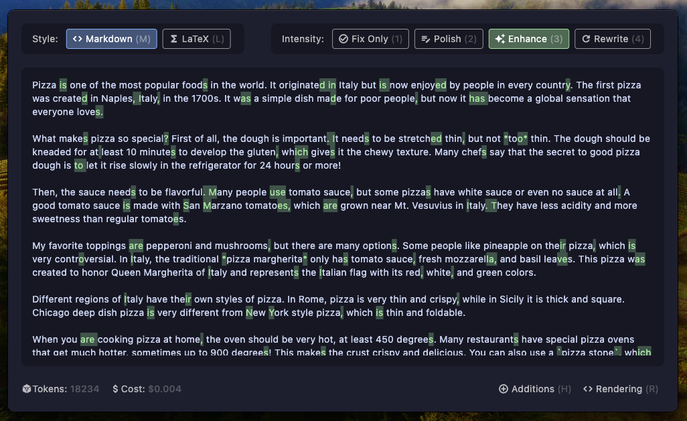

# GrammarGuard

**Enhance, rewrite, and format selected text from anywhere on macOS.**

## Overview

GrammarGuard is a macOS application built with Flutter, designed to seamlessly integrate into your writing workflow. It
runs discreetly in the background, ready to help you improve any text you select, anywhere on your system.

Forget the copy-paste-edit-copy-back routine. With GrammarGuard, simply select text in any application, press a
shortcut, and instantly get suggestions for:

* Correcting spelling and grammar
* Rewriting text with adjustable intensity – from subtle polishing to significant rephrasing
* Adding Markdown or LaTeX formatting

GrammarGuard appears in a convenient floating window, allowing for quick refinements without disrupting your focus.

**Note:** Currently available exclusively for **macOS** due to the reliance on OS-specific features for text
capture and window management.

## Features

* **System-Wide Text Capture:** Grabs text from your clipboard when triggered
* **Background Operation:** Runs unobtrusively until needed
* **Floating Window UI:** Appears on top of other windows for easy access upon activation
* **Global Shortcut Activation:** Trigger GrammarGuard with `Alt+Shift+G`
* **Text Rewriting with Multiple Intensities:**
    * *Fix Only:* Basic grammar and spelling corrections
    * *Polish:* Minor tweaks and fluency improvements
    * *Enhance:* Moderate improvements to clarity and style
    * *Rewrite:* Significant rephrasing while preserving meaning
* **Formatting Options:** Toggle Markdown or LaTeX syntax integration
* **Diff View:** Toggle between original and rewritten text to see changes
* **Keyboard Shortcuts:** Quick access to all features
* **Beautiful UI:** Light and dark themes with Catppuccin color scheme
* **Secure API Key Storage:** Safely stores your Google AI (Gemini) API key

## How It Works

1. **Background Listener:** GrammarGuard runs in the background, listening for the global keyboard shortcut (`Alt+Shift+G`)
2. **Text Capture:** When the shortcut is pressed, GrammarGuard retrieves text from your clipboard
3. **Floating Window:** A floating window appears instantly on top of your current application, displaying the captured text
4. **Processing:** The text is sent to Google's Gemini AI for processing based on your selected intensity and formatting options
5. **Refinement & Display:** GrammarGuard shows the original text and the AI-generated suggestions
6. **Output:** Review the suggestions and press `Enter` to copy the desired version to your clipboard
7. **Dismissal:** The floating window can be dismissed by pressing `Esc` or clicking outside

## Keyboard Shortcuts

* `Alt+Shift+G`: Show/hide GrammarGuard
* `1-4`: Set rewrite intensity (1=fix only, 2=polish, 3=enhance, 4=rewrite)
* `M`: Toggle Markdown formatting
* `L`: Toggle LaTeX formatting
* `H`: Toggle diff view
* `R`: Toggle rendering mode
* `↑/↓` or `J/K`: Scroll text
* `U/D`: Scroll text by half page
* `Enter`: Copy improved text to clipboard
* `Esc`: Dismiss window

## Installation (macOS)

**Building from Source (Recommended for Development):**

1. Ensure you have Flutter installed for macOS development: [https://docs.flutter.dev/desktop#macos](https://docs.flutter.dev/desktop#macos)
2. Clone the repository: `git clone https://github.com/gabber235/GrammarGuard.git`
3. Navigate to the project directory: `cd GrammarGuard`
4. Switch to the beta branch of Flutter: `flutter channel beta`
5. Install dependencies: `flutter pub get`
6. Enable macOS desktop support if not already: `flutter config --enable-macos-desktop`
7. Run the application: `flutter run -d macos`

## First-Time Setup

1. Launch GrammarGuard
2. You'll be prompted to enter your Google AI (Gemini) API key
3. Get your API key from: https://makersuite.google.com/app/apikey
4. Enter your API key in the setup screen
5. The app will securely store your API key and be ready to use

## Usage

1. Launch GrammarGuard. It will run in the background
2. Copy text from any application
3. Press `Alt+Shift+G`
4. The GrammarGuard floating window appears with your text
5. Use keyboard shortcuts to:
    * Adjust rewriting intensity (1-4)
    * Toggle Markdown/LaTeX formatting (M/L)
    * Toggle diff view (H)
    * Toggle rendering mode (R)
6. Review the improved text
7. Press `Enter` to copy the refined text to your clipboard
8. Press `Esc` or click outside the window to dismiss GrammarGuard
9. Paste the improved text (`Cmd+V`) into your original application

## Contributing

Contributions are welcome! Please follow these steps:

1. Fork the repository (`https://github.com/gabber235/GrammarGuard/fork`)
2. Create a new branch (`git checkout -b feature/your-feature-name`)
3. Make your changes
4. Commit your changes (`git commit -m 'Add some feature'`)
5. Push to the branch (`git push origin feature/your-feature-name`)
6. Open a Pull Request against the `main` branch

Please ensure your code adheres to the project's coding standards and includes tests where applicable. Report bugs or suggest features using the [GitHub Issues tab](https://github.com/gabber235/GrammarGuard/issues).